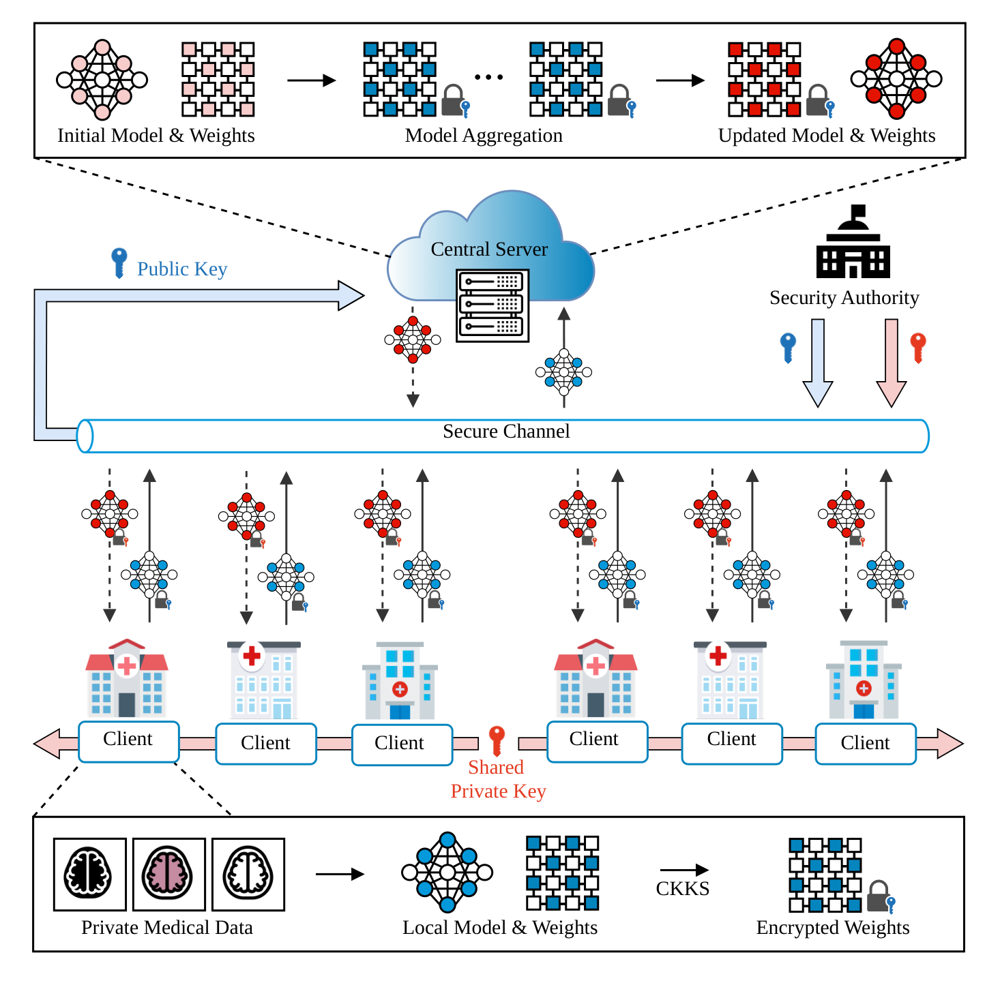
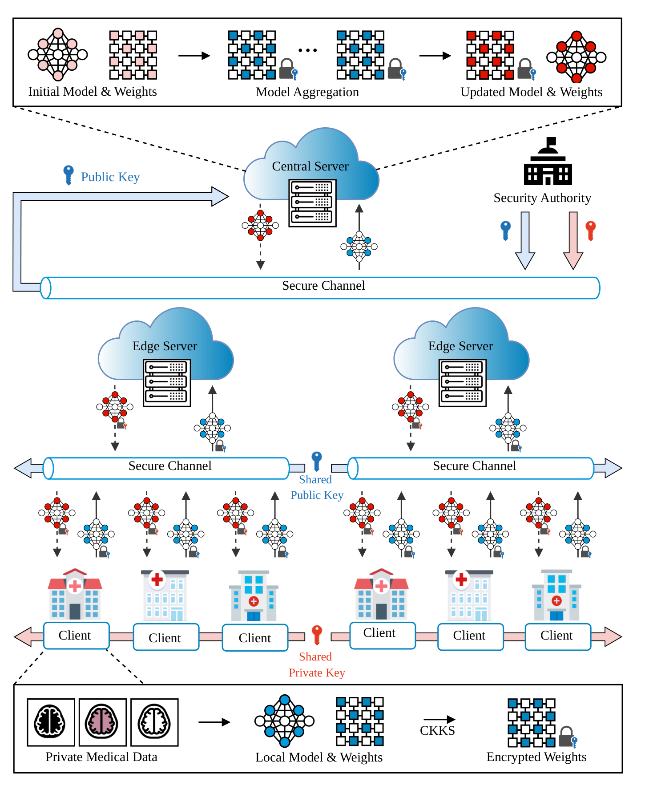
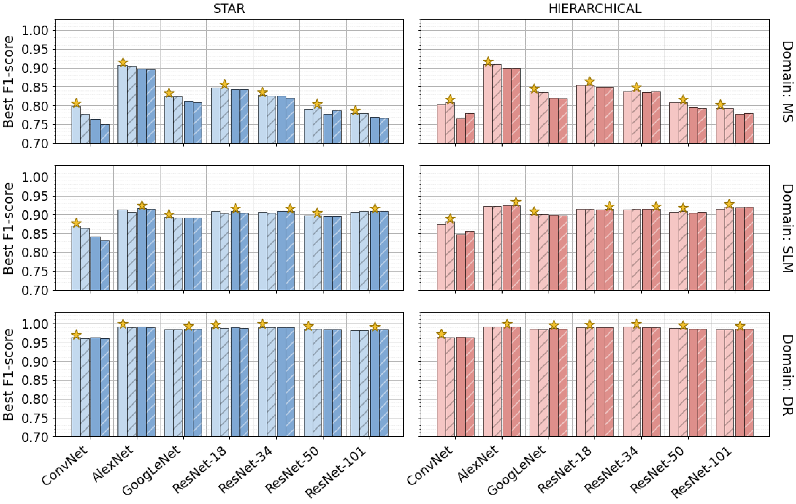
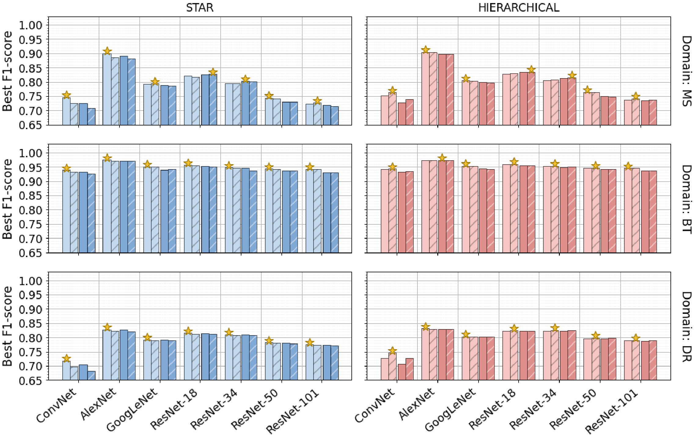
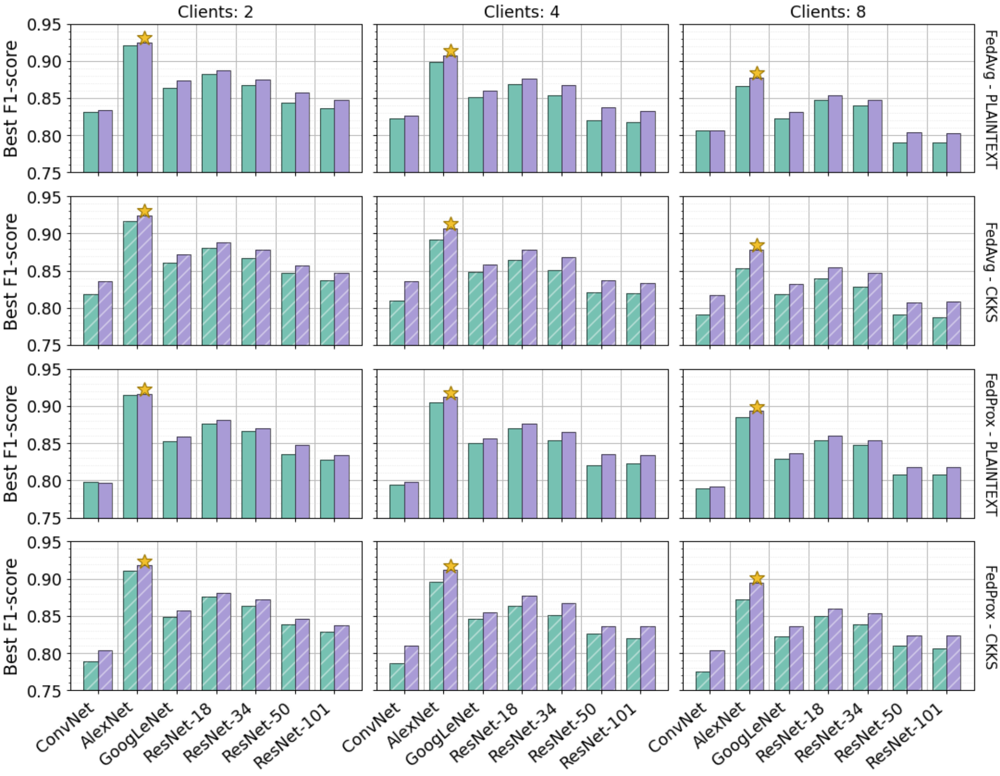
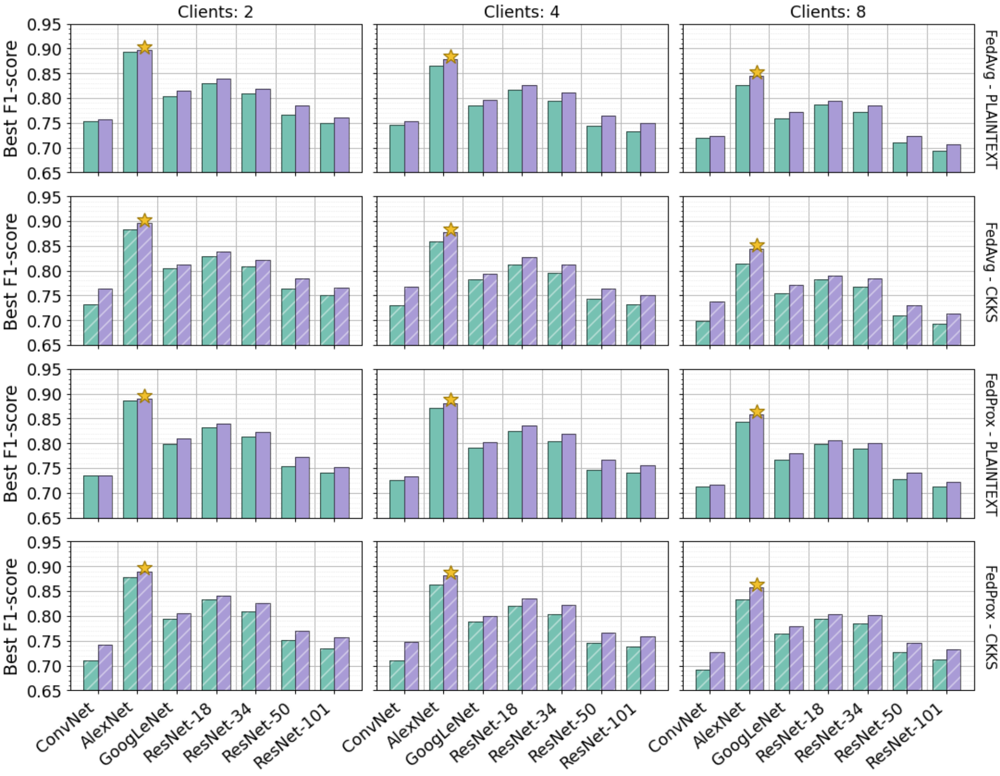
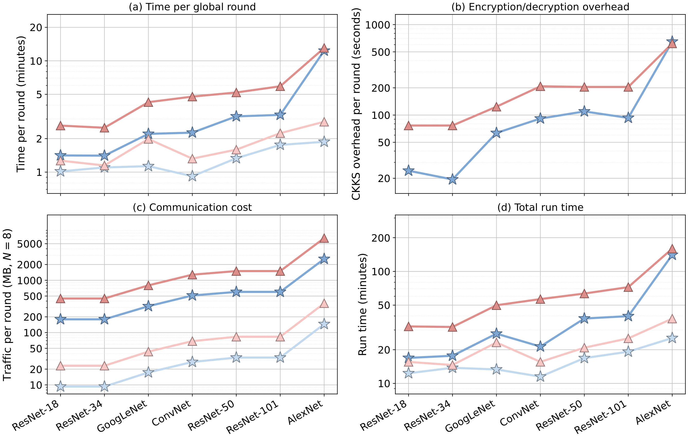

# HERMES-FL: Homomorphically Encrypted Federated Learning for Multi-Domain Medical Image Classification

<p align="center">
Raffaele Aurucci<sup>1</sup>, Stefano Cirillo<sup>1</sup>, Vincenzo Deufemia<sup>1</sup>, Luigi Di Biasi<sup>1</sup>, Giuseppe Polese<sup>1</sup>, Giandomenico Solimando<sup>1,*</sup>, Genoveffa Tortora<sup>1</sup>
</p>

<p align="center">
<sup>1</sup> Department of Computer Science, University of Salerno, Via Giovanni Paolo II, 132, 84084 Fisciano (SA), Italy<br>
<sup>*</sup> Corresponding author<br>
<code>{raurucci, scirillo, deufemia, ldibiasi, gpolese, gsolimando, tortora}@unisa.it</code>
</p>

## Abstract

Cross-institutional collaboration could yield more reliable diagnostic models, yet privacy regulations constrain the sharing of clinical images. Federated learning keeps the data local, but the model updates exchanged during training can still leak patient information. This paper presents HERMES-FL, a federated learning framework that encrypts the model updates of each client with the Cheon–Kim–Kim–Song homomorphic encryption scheme, so that no aggregation server, central or edge, observes them in plaintext. We evaluate HERMES-FL on four medical imaging tasks, multiple sclerosis, brain tumor, skin lesion malignancy, and diabetic retinopathy, with ten image collections, 24 dataset configurations, seven network architectures, and both star and hierarchical topologies. Six of the seven architectures train only a classification head over a frozen pre-trained backbone, which keeps the encrypted payload small. The best F1-scores range from 0.83 for three-class diabetic retinopathy grading to 0.99 for binary retinopathy detection. Encrypted aggregation matches plaintext aggregation, with a mean F1-score difference of about 0.003 and the same ranking of models. Under encryption, the hierarchical topology reaches a higher F1-score than the star topology in every binary comparison, and its central server receives half as many updates. Encryption raises the median run time by a factor of 2.20 in the star topology and 2.41 in the hierarchical one, and the factor grows with the size of the exchanged model, from 1.41 for ResNet-18 to 7.15 for AlexNet. Encrypting updates preserves classification performance, with costs driven mainly by model size.

## Contributions

- A federated learning framework for medical image classification that aggregates encrypted model parameters under both star and hierarchical topologies, without exposing plaintext updates to any aggregation server.
- An experimental evaluation across four medical imaging domains, covering ten image collections, 24 dataset configurations, and seven neural network architectures.
- A comparison of encrypted and plaintext aggregation under both topologies, with different client counts and federated optimization algorithms, in terms of classification performance, total execution time, and estimated communication volume.

## The HERMES-FL framework

HERMES-FL (**H**omomorphic **E**ncryption-based **R**obust **M**edical **E**dge **S**ystem for **F**ederated **L**earning) involves three computational entities, namely **Edge Clients** (medical institutions holding private image datasets), **Edge Aggregators** (hierarchical topology only), and a **Central Server**, plus a trusted **Key Management Service** (Trusted Authority) that generates the CKKS key pair. The secret key is delivered only to the clients, whereas the public key is shared with the central server and the edge aggregators, so that **no aggregation node can ever decrypt a model update**.

Each client follows a **federated transfer learning** strategy: a pre-trained backbone (ResNet-18/34/50/101, GoogLeNet, AlexNet; ImageNet-1k weights) is frozen, and only a classification head of $L \in \{2, 4\}$ fully connected layers is trained and exchanged, which reduces both local computation and the size of the encrypted payload. A lightweight **ConvNet** trained from scratch, whose parameters are all exchanged, is included as a baseline.

### Star topology

<p align="center">
  
</p>

<p align="center"><i><b>Figure 1.</b> Overview of the HERMES-FL star topology. The security authority distributes the CKKS public key and the private key shared by the clients. Starting from the initial model, each client trains locally on its private medical data, encrypts the updated classification layers, and transmits the ciphertexts through a secure channel directly to the central server, which aggregates them homomorphically and returns the encrypted updated model to the clients.</i></p>

At round $t$, each selected client $C_i$ trains its head locally, encrypts the weights $\mathbf{w}^{(t)}_{C_i}$ with CKKS, and sends the ciphertext together with the size $Q_{C_i}$ of its training subset. The central server computes the data-weighted average entirely in the encrypted domain,

$$
[\![\mathbf{w}^{(t+1)}]\!] = \bigoplus_{C_i \in \mathcal{C}^{(t)}} \alpha^{(t)}_{C_i} \odot [\![\mathbf{w}^{(t)}_{C_i}]\!], \qquad \alpha^{(t)}_{C_i} = \frac{Q_{C_i}}{Q^{(t)}},
$$

using only plaintext–ciphertext scalar multiplications ($\odot$) and ciphertext additions ($\oplus$), i.e., a multiplicative depth of one. The encrypted global model is broadcast back to the clients, which decrypt it locally with the secret key.

### Hierarchical topology

<p align="center">
  
</p>

<p align="center"><i><b>Figure 2.</b> Overview of the HERMES-FL hierarchical topology. Edge aggregators combine encrypted parameters from regional client clusters before forwarding intermediate ciphertexts to the central server.</i></p>

The clients are partitioned into disjoint regional clusters, each managed by an **edge aggregator** (e.g., the data center of a hospital consortium or of a regional health authority). Aggregation runs in **two encrypted stages**: each edge aggregator $E_j$ computes the encrypted cluster average of its selected clients and forwards it, together with the cluster size $Q^{(t)}_{E_j}$, to the central server, which combines the cluster averages:

$$
[\![\mathbf{w}^{(t+1)}_{E_j}]\!] = \bigoplus_{C_i \in \mathcal{C}^{(t)}_{E_j}} \frac{Q_{C_i}}{Q^{(t)}_{E_j}} \odot [\![\mathbf{w}^{(t)}_{C_i}]\!], \qquad
[\![\mathbf{w}^{(t+1)}]\!] = \bigoplus_{E_j \in \mathcal{E}^{(t)}} \frac{Q^{(t)}_{E_j}}{Q^{(t)}} \odot [\![\mathbf{w}^{(t+1)}_{E_j}]\!].
$$

The cascade yields the same weighted average as the star topology, up to the CKKS approximation error, and consumes exactly the two levels of the modulus chain. Each global round comprises $R_e = 2$ edge rounds, in which the edge aggregator redistributes the (still encrypted) cluster model to its clients before forwarding the result upstream; under FedProx, the proximal term is always anchored to the global model received from the central server.

### CKKS configuration and federated optimization

The CKKS context uses a polynomial modulus degree $n = 8192$ (4096 packed slots per ciphertext), a coefficient modulus chain of bit sizes $\{60, 40, 40, 60\}$ (128-bit security), and a global scale $\Delta = 2^{40}$. The flattened trainable parameters of each layer are split into chunks of 4096 values, each encrypted as a separate ciphertext. Since the aggregation involves no ciphertext–ciphertext multiplication or rotation, no relinearization or Galois keys are generated. The framework supports **FedAvg**, **FedProx** (proximal term $\frac{\mu}{2}\lVert \mathbf{w}_{C_i} - \mathbf{w}^{(t)} \rVert^2$), and **FedLC** (logit calibration with $\tau_y = \pi_y^{-1/4}$), which share the same encrypted aggregation and differ only in the local objective.

## Datasets

HERMES-FL is evaluated on ten image collections from four clinical domains, which yield 16 base dataset configurations (binary and multiclass labelings of the MS and DR collections) and, with the eight augmented MS configurations, **24 dataset configurations**.

| Domain | Configuration(s) | Task | Classes | Images | Source |
|:--|:--|:--|:--|--:|:--|
| Multiple Sclerosis (MS) | MS-MRI-MULTI / FLAIR / T1 / T2 | Binary | EDSS ≤ 2.5 vs. ≥ 3.0 | 4,191 / 1,452 / 1,358 / 1,381 | Muslim et al., *Data in Brief* 42 (2022) — [Mendeley Data](https://data.mendeley.com/datasets/8bctsm8jz7/1) |
| Multiple Sclerosis (MS) | MS-MRI-MULTI / FLAIR / T1 / T2 | Multiclass | Normal, Mild, Severe | 4,189 / 1,451 / 1,358 / 1,380 | as above |
| Multiple Sclerosis (MS) | Augmented versions of the eight configurations above | Binary / Multiclass | as above | 4× the original | as above |
| Brain Tumor (BT) | BT-MRI | Multiclass | Glioma, Meningioma, Pituitary, No Tumor | 5,723 | [Brain Tumor MRI Dataset (Kaggle)](https://www.kaggle.com/dsv/14832123) |
| Skin Lesion Malignancy (SLM) | SLM-HAM10000 | Binary | Benign, Malignant | 4,499 | [HAM10000 (Harvard Dataverse)](https://doi.org/10.7910/DVN/DBW86T) |
| Skin Lesion Malignancy (SLM) | SLM-ISIC1 / SLM-ISIC2 | Binary | Benign, Malignant | 2,022 / 12,022 | [ISIC Archive](https://challenge.isic-archive.com/data/), [SIIM-ISIC Melanoma Classification (Kaggle)](https://www.kaggle.com/competitions/siim-isic-melanoma-classification) |
| Diabetic Retinopathy (DR) | DR-COLORED / DR-KDR299 | Binary | No-DR, Proliferative DR | 2,100 / 2,100 | [APTOS 2019 Blindness Detection (Kaggle)](https://www.kaggle.com/competitions/aptos2019-blindness-detection/data) |
| Diabetic Retinopathy (DR) | DR-COLORED / DR-KDR299 | Multiclass | Mild, Moderate, Severe | 1,562 / 1,562 | as above |

The MS slices are derived from the multi-sequence MRI collection of 60 patients released by Muslim et al., labeled from the patients' EDSS scores; the DR configurations are obtained from the APTOS 2019 fundus images through two different enhancement pipelines. The preprocessed configurations used in the paper (MS relabeling and augmentation, DR enhancement, SLM subsets) cannot be redistributed, but may be obtained upon reasonable request to the corresponding author for non-commercial research only, subject to a data-sharing agreement and institutional ethics approval.

### Data partitioning

Before each federated run, every dataset is partitioned into $N$ disjoint client-local datasets. Class labels are inferred from the directory structure (one sub-folder per class). For the MS collections, the filenames carry the patient identifier (`<patient>_<sequence>_slice<k>_EDSS<s>[_aug<j>].png`) and the partitioning is performed **at patient level**: all the slices of a patient, together with all their augmented copies, form a single unit, so that no patient is shared by two clients or by the training, validation, and test subsets of the same client. Units are assigned through a **greedy bin-packing heuristic** that visits them from the largest to the smallest and places each one where it least increases the deviation of the per-class counts from their targets $|\mathcal{D}|_c/N$ (ties broken pseudo-randomly). Collections without a patient identifier are partitioned with the same procedure at image level. Each client-local dataset is then divided, again at patient level, into a **training (70%)**, a **validation (15%)**, and a **test (15%)** subset. The training subset is the only data used for local optimization; the validation subset is used for model selection and early stopping, and the test subset only to report the final metrics.

## Experimental setup

Each configuration of the search space below is executed as an independent federated run, with its own key generation, data partition, and model initialization, for every dataset configuration and backbone.

| Searched | Values | Fixed | Value |
|:--|:--|:--|:--|
| Topology | star, hierarchical | Optimizer | Adam (no weight decay) |
| Encryption | none, CKKS | Learning rate | $10^{-3}$ |
| Global rounds $T$ | 5, 10, 20, 30 | LR scheduler | plateau on training loss (×0.1, patience 3) |
| Local epochs $E$ | 2, 5 | Batch size | 16 |
| Clients $N$ | 2, 4, 8 | Join ratio $\rho$ | 1 |
| Algorithm | FedAvg, FedProx | FedProx $\mu$ | 0.05 |
| Image size | 128 × 128, 224 × 224 | Edge rounds $R_e$ (hierarchical) | 2 |
| Head depth $L$ (pre-trained backbones) | 2, 4 | Clients per edge aggregator | 2 ($\lvert\mathcal{E}\rvert = N/2$) |
| | | Early stopping | validation loss increasing for 5 consecutive rounds |

The global model is evaluated at the end of every global round on the clients' validation and test subsets; metrics (accuracy, weighted precision, recall, and F1-score, and cross-entropy loss) are averaged over the clients weighted by the size of their evaluation subsets. The best round maximizes the global **validation** F1-score, and the **test** metrics of that round's global model are reported, so that test data never influence model selection.

## Results

### Classification performance under CKKS

Best test F1-score on each dataset with CKKS-encrypted aggregation, per model and per number of clients $N$ (scores averaged over the star and hierarchical topologies; R-$n$ denotes ResNet-$n$; ConvNet is trained from scratch, all the other models are pre-trained; the best value of each group is in bold).

**Table 1.** Binary tasks.

| Domain | Dataset | ConvNet | AlexNet | GoogLeNet | R-18 | R-34 | R-50 | R-101 | N=2 | N=4 | N=8 |
|:--|:--|--:|--:|--:|--:|--:|--:|--:|--:|--:|--:|
| MS | MS-MRI-MULTI | 0.866 | **0.906** | 0.780 | 0.804 | 0.787 | 0.762 | 0.737 | **0.906** | 0.878 | 0.837 |
| MS | MS-MRI-FLAIR | 0.890 | **0.923** | 0.784 | 0.841 | 0.816 | 0.796 | 0.809 | **0.923** | 0.906 | 0.865 |
| MS | MS-MRI-T1 | 0.866 | **0.924** | 0.812 | 0.865 | 0.823 | 0.805 | 0.781 | **0.924** | 0.876 | 0.839 |
| MS | MS-MRI-T2 | 0.859 | **0.873** | 0.786 | 0.781 | 0.785 | 0.780 | 0.738 | **0.873** | 0.867 | 0.859 |
| MS | MS-MRI-MULTI (Aug) | 0.688 | **0.881** | 0.818 | 0.844 | 0.835 | 0.806 | 0.774 | **0.881** | 0.865 | 0.820 |
| MS | MS-MRI-FLAIR (Aug) | 0.700 | **0.916** | 0.884 | 0.888 | 0.880 | 0.841 | 0.847 | **0.916** | 0.895 | 0.882 |
| MS | MS-MRI-T1 (Aug) | 0.699 | **0.916** | 0.893 | 0.913 | 0.887 | 0.846 | 0.825 | **0.916** | 0.894 | 0.878 |
| MS | MS-MRI-T2 (Aug) | 0.726 | **0.894** | 0.868 | 0.871 | 0.866 | 0.817 | 0.802 | **0.894** | 0.859 | 0.855 |
| SLM | SLM-HAM10000 | 0.741 | **0.834** | 0.780 | 0.814 | 0.820 | 0.809 | 0.816 | **0.834** | 0.824 | 0.824 |
| SLM | SLM-ISIC1 | 0.893 | 0.930 | 0.916 | 0.928 | 0.930 | 0.915 | **0.946** | 0.907 | **0.946** | 0.913 |
| SLM | SLM-ISIC2 | 0.975 | **0.990** | 0.987 | 0.987 | 0.984 | 0.983 | 0.982 | **0.990** | 0.989 | 0.987 |
| DR | DR-COLORED | 0.959 | **0.991** | 0.986 | 0.988 | 0.990 | 0.987 | 0.986 | 0.990 | **0.991** | 0.981 |
| DR | DR-KDR299 | 0.964 | **0.991** | 0.986 | 0.990 | 0.990 | 0.987 | 0.982 | 0.990 | **0.991** | 0.984 |

**Table 2.** Multiclass tasks.

| Domain | Dataset | ConvNet | AlexNet | GoogLeNet | R-18 | R-34 | R-50 | R-101 | N=2 | N=4 | N=8 |
|:--|:--|--:|--:|--:|--:|--:|--:|--:|--:|--:|--:|
| MS | MS-MRI-MULTI | 0.855 | **0.922** | 0.737 | 0.795 | 0.766 | 0.704 | 0.677 | **0.922** | 0.896 | 0.863 |
| MS | MS-MRI-FLAIR | 0.895 | **0.899** | 0.767 | 0.829 | 0.791 | 0.733 | 0.736 | **0.899** | 0.879 | 0.853 |
| MS | MS-MRI-T1 | 0.859 | **0.927** | 0.780 | 0.846 | 0.797 | 0.733 | 0.748 | **0.927** | 0.890 | 0.863 |
| MS | MS-MRI-T2 | 0.807 | **0.864** | 0.729 | 0.732 | 0.733 | 0.719 | 0.684 | **0.864** | 0.852 | 0.831 |
| MS | MS-MRI-MULTI (Aug) | 0.619 | **0.873** | 0.793 | 0.811 | 0.794 | 0.743 | 0.732 | **0.873** | 0.856 | 0.809 |
| MS | MS-MRI-FLAIR (Aug) | 0.607 | **0.898** | 0.869 | 0.880 | 0.855 | 0.788 | 0.781 | 0.895 | **0.898** | 0.867 |
| MS | MS-MRI-T1 (Aug) | 0.672 | **0.906** | 0.902 | 0.898 | 0.889 | 0.838 | 0.792 | **0.906** | 0.898 | 0.871 |
| MS | MS-MRI-T2 (Aug) | 0.617 | **0.875** | 0.825 | 0.857 | 0.848 | 0.787 | 0.779 | **0.875** | 0.855 | 0.842 |
| BT | BT-MRI | 0.929 | **0.972** | 0.952 | 0.957 | 0.949 | 0.944 | 0.943 | **0.972** | 0.965 | 0.971 |
| DR | DR-COLORED | 0.728 | 0.822 | 0.823 | 0.820 | **0.832** | 0.818 | 0.807 | 0.825 | 0.828 | **0.832** |
| DR | DR-KDR299 | 0.716 | **0.827** | 0.770 | 0.814 | 0.800 | 0.761 | 0.752 | **0.827** | 0.815 | 0.783 |

AlexNet is the best model on all MS datasets in both tasks, BT-MRI is the only dataset on which every model exceeds an F1-score of 0.92, and multiclass DR grading is the hardest task (best F1-score of 0.832). On MS, the F1-score generally decreases as the number of clients grows.

### Encrypted vs. plaintext aggregation

<p align="center">
  
</p>

<p align="center">
  
  
</p>

<p align="center"><i><b>Figure 3.</b> Encrypted vs. plaintext aggregation: best F1-score (maximum over the parameter grid, averaged per domain) per model and domain (rows) under plaintext (plain bars) and CKKS-encrypted (hatched bars) aggregation in the star (left) and hierarchical (right) topologies, for (a, left) the binary and (b, right) the multiclass tasks. Stars mark the best bar of each model.</i></p>

CKKS and plaintext aggregation give nearly the same F1-scores, with an average difference of about **0.003** in both tasks, no consistent sign, and an **unchanged model ranking**: since the servers only add ciphertexts scaled by plaintext weights, the CKKS approximation error is the only perturbation. FedAvg and FedProx perform alike, except that FedProx lowers the F1-score of the ConvNet more than that of the other models.

### Star vs. hierarchical topology

<p align="center">
  
</p>

<p align="center">
  
  
</p>

<p align="center"><i><b>Figure 4.</b> Star vs. hierarchical topology: best F1-score per model in the star (green) and hierarchical (purple) topologies across algorithms and aggregation modes (rows) and numbers of clients (columns), for (a, left) the binary and (b, right) the multiclass tasks. Stars mark the best bars.</i></p>

The hierarchical topology scores higher than the star topology in **42 of 42** binary comparisons with CKKS, in 41 of 42 in plaintext, and in almost every multiclass comparison, with the same model ranking in both topologies. Under CKKS, the F1-score increases by 0.015 (binary) and 0.019 (multiclass), and the advantage grows with the number of clients: the $R_e = 2$ edge rounds synchronize clients more often and limit divergence on small partitions, while the central server receives $N/2$ updates instead of $N$.

### Scalability and computational overhead

<p align="center">
  
</p>

<p align="center">
  
</p>

<p align="center"><i><b>Figure 5.</b> Cost per model, ordered by the number of exchanged parameters (log scale): (a) time per global round, (b) CKKS overhead per round, i.e., runtime difference between CKKS and plaintext runs with the same configuration divided by the executed rounds, (c) traffic per global round with N = 8, and (d) total run time. Medians over all datasets and configurations.</i></p>

| | Star | Hierarchical |
|:--|--:|--:|
| Time per round, plaintext (median) | 1.13 min | 1.59 min |
| Time per round, CKKS (median) | 2.26 min | 4.77 min |
| Run-time overhead of CKKS (median) | 2.20× | 2.41× |
| Transfers per round | $2N$ | $5N$ |
| Updates received by the central server per round | $N$ | $N/2$ |

The CKKS cost follows the number of 4096-slot ciphertexts per update, from 41 for ResNet-18 (11.2 MB per update, **1.41×** run time) to 585 for AlexNet (160.0 MB per update, **7.15×** run time). AlexNet is the most accurate model, but ResNet-18 exchanges about fourteen times fewer ciphertexts and offers the best trade-off between F1-score and cost under a limited budget.

## Repository structure

```
HERMES-FL/
├── star/                        # Star topology
│   ├── federated_server.py      # Central server: orchestration and (encrypted) aggregation
│   ├── federated_client.py      # Client: local training, CKKS encryption/decryption, evaluation
│   ├── run_multiple_clients.py  # Data partitioning + launch of the clients of one run
│   ├── trusted_authority.py     # Key Management Service: CKKS context and key distribution
│   ├── aggregator.py            # Weighted (encrypted) aggregation, model selection, results
│   ├── model_manager.py         # Backbones, classification heads, ConvNet, FedAvg/FedProx/FedLC
│   ├── data_splitter.py         # Patient-level greedy bin-packing partition, 70/15/15 split
│   ├── utils.py                 # CKKS helpers (TenSEAL), serialization, networking
│   ├── federated_grid_search.py # Grid-search orchestrator
│   ├── grid_search_config.json  # Datasets and search space
│   ├── run_no_encryption.py     # Plaintext grid search
│   ├── run_ckks.py              # CKKS grid search
│   └── results/                 # Grid-search results of the paper (one row per configuration)
│       ├── star_no_enc.csv      #   plaintext aggregation
│       └── star_ckks.csv        #   CKKS-encrypted aggregation
├── hierarchical/                # Hierarchical topology (same structure as star/, plus:)
│   ├── central_server.py        # Global aggregation of the encrypted cluster averages
│   ├── edge_server.py           # Edge aggregator: cluster aggregation and edge rounds
│   ├── run_hierarchical.py      # Launch of the central/edge/client stack of one run
│   └── results/
│       ├── hierarchical_no_enc.csv
│       └── hierarchical_ckks.csv
├── scripts/                     # Generation of the result figures from the four results CSVs
│   ├── common.py                # Loading of the CSVs, constants, plot style, PDF/PNG export
│   ├── plot_enc_vs_plain.py     # Encrypted vs. plaintext aggregation (Figure 3, legend_bars)
│   ├── plot_star_vs_hierarchical.py  # Star vs. hierarchical topology (Figure 4, legend_topo)
│   ├── plot_runtime.py          # Scalability and computational overhead (Figure 5)
│   └── make_all_figures.py      # Runs the three scripts above
├── figures/                     # Architecture diagrams: star and hierarchical topologies (PNG, PDF)
├── plots/                       # Result plots generated by scripts/ (PDF of the paper, PNG of this README)
└── requirements.txt
```

## Getting started

The project requires **Python 3.11**, and a CUDA-capable GPU is strongly recommended (the experiments used PyTorch 2.10.0 and torchvision 0.25.0 with CUDA 12.6). CKKS is provided by **TenSEAL 0.3.16**, and all the entities communicate via **Flask-SocketIO** over WebSocket.

### 1. Clone the repository

```bash
git clone https://github.com/DaisLab-Unisa/HERMES-FL.git
cd HERMES-FL
```

### 2. Create and activate a virtual environment

**Windows (PowerShell):**
```powershell
py -3.11 -m venv .venv
.venv\Scripts\Activate.ps1
```

**Linux / macOS:**
```bash
python3.11 -m venv .venv
source .venv/bin/activate
```

### 3. Install the dependencies

PyTorch must be installed first from the CUDA index, then the remaining requirements:

```bash
pip install --upgrade pip
pip install torch==2.10.0 torchvision==0.25.0 --index-url https://download.pytorch.org/whl/cu126
pip install -r requirements.txt
```

### 4. Prepare the datasets

Place each dataset configuration under `datasets/` at the repository root, with one sub-folder per class, at the paths listed in `grid_search_config.json` (e.g., `datasets/dataset_slices_sorted/class_0/`, `datasets/brain_tumor/train/glioma/`). MS images must keep the patient identifier as filename prefix (`<patient>_<sequence>_slice<k>_EDSS<s>[_aug<j>].png`) to enable patient-level partitioning.

### 5. Run the framework

Launch the grid search from inside the topology folder:

```bash
# Star topology
cd star
python run_no_encryption.py   # plaintext baseline
python run_ckks.py            # CKKS-encrypted aggregation

# Hierarchical topology
cd ../hierarchical
python run_no_encryption.py   # plaintext baseline
python run_ckks.py            # CKKS-encrypted aggregation
```

Plaintext and CKKS runs use separate port blocks and output folders, so they can run concurrently, also across the two topologies. Results are written to `results/results_star/` and `results/results_hierarchical/`: a global summary CSV with one row per run (hyperparameters, `best_round`, the validation metrics of the selected round `best_val_*`, and its test metrics `test_*`), a per-round CSV with the training loss and the validation and test metrics, and the logs. The search space can be narrowed by editing `common_search_space` and `model_specific_search_space` in `grid_search_config.json`.

### 6. Reproduce the figures

The result figures are generated from the four CSVs in `star/results/` and `hierarchical/results/` (matplotlib 3.10.9, seaborn, and PyMuPDF, all included in `requirements.txt`). From the repository root:

```bash
python scripts/make_all_figures.py              # all the figures
python scripts/plot_enc_vs_plain.py             # only Figure 3 (+ legend_bars)
python scripts/plot_star_vs_hierarchical.py     # only Figure 4 (+ legend_topo)
python scripts/plot_runtime.py                  # only Figure 5 (+ legend_runtime_plot)
```

By default the plots are saved to `plots/`, overwriting the published ones, with the same file names: one PDF per figure (the version used in the paper) and a PNG preview at 200 dpi (the version shown in this README). To write them elsewhere, pass an output directory, which is created if it does not exist:

```bash
python scripts/make_all_figures.py --out my_figures
```

| Script | Generated files |
|:--|:--|
| `plot_enc_vs_plain.py` | `binary_enc_domain`, `multiclass_enc_domain`, `legend_bars` |
| `plot_star_vs_hierarchical.py` | `binary_topo_backbone`, `multiclass_topo_backbone`, `legend_topo` |
| `plot_runtime.py` | `runtime_plot`, `legend_runtime_plot` |

## Citation

Please cite our work if you use it in your research:

```bibtex
@article{hermesfl,
  title   = {HERMES-FL: Homomorphically Encrypted Federated Learning for Multi-Domain Medical Image Classification},
  author  = {Aurucci, Raffaele and Cirillo, Stefano and Deufemia, Vincenzo and Di Biasi, Luigi and Polese, Giuseppe and Solimando, Giandomenico and Tortora, Genoveffa},
  journal = {TBD},
  year    = {TBD}
}
```
